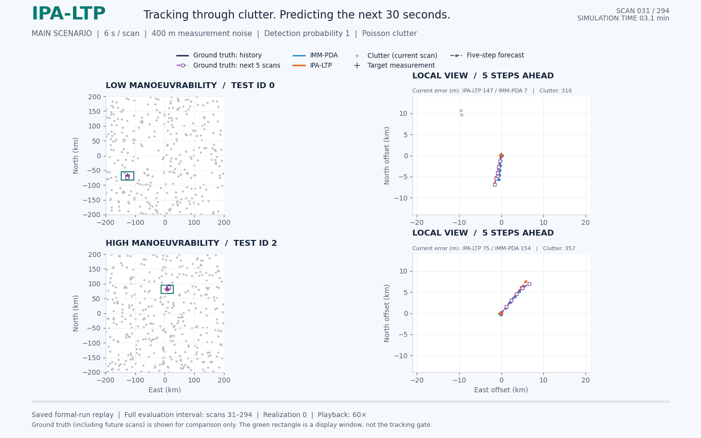

# IPA-LTP

**IPA-LTP: Radar Target Tracking and Multistep Prediction From Measurements in Clutter**

*Two saved Monte Carlo runs under low and high manoeuvrability: dark lines are the
ground-truth history, purple dashed lines with hollow squares are the future ground
truth, gray dots and dark crosses are clutter and target-originated measurements,
blue lines are IMM–PDA estimates, and orange lines are IPA–LTP estimates. Dashed
lines with circular markers show five-step forecasts. Future ground truth is shown
only for comparison and is not supplied to either method.*

---

> **Note:** The source code, model weights, data, and evaluation scripts for this
> project are currently withheld while the accompanying paper is under peer review.
> **The full code will be made publicly available here upon acceptance.**
